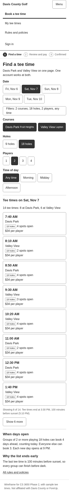

# Phase 2: Information Design & IA Mapping

**Restructuring Tee Time Booking at Davis County's Two Public Golf Courses**

Luke Peterson · CS 3650 Human-Computer Interaction · Weber State University · November 2026

Research repository: [github.com/hqluke/3650-Research](https://github.com/hqluke/3650-Research)

> [!summary] Summary
> ForeUp makes golfers at Davis Park and Valley View pick a booking class before they see any times, and each course has its own site and account. I ran an open card sort with three people to see how they'd group the booking tasks, then built a sitemap, two user flows, nine wireframes, and a keyboard and screen reader plan from what they did.
>
> - All three put the same nine cards together, including "Book as a single golfer." Nobody made a group for booking classes, so the new design doesn't have a class picker.
> - Nobody put the cancellation policy, "See why there are no tee times," or "See when new days open" with booking. I had expected them to.
> - The new site has one account, one page for both courses, and nothing more than two levels deep.

## 1. Card Sorting Study

### 1.1 Card Deck

I wrote 18 cards from what golfers do on ForeUp (Phase 1) and what my Case Study 02 prototype added. They're in plain words instead of ForeUp's labels, so "Book as a single golfer" doesn't teach anyone ForeUp's booking classes. The deck and script are in [`card-sort/protocol.md`](card-sort/protocol.md).

| # | Card | # | Card |
| --- | --- | --- | --- |
| 1 | Pick a date | 10 | Log in or create an account |
| 2 | Choose 9 or 18 holes | 11 | Use a season pass |
| 3 | Choose how many players | 12 | See your upcoming tee times |
| 4 | Choose morning, afternoon, or evening | 13 | Cancel a tee time |
| 5 | Pick Davis Park or Valley View | 14 | Read the cancellation policy |
| 6 | See open tee times at both courses | 15 | See when new days open for booking |
| 7 | Book as a single golfer | 16 | See why there are no tee times |
| 8 | Choose a cart or walking | 17 | Find the last tee time before sunset |
| 9 | Pay for your group | 18 | Get your confirmation email |

### 1.2 Method

It was an open card sort in Trello, so people made their own groups and named them. Each person got a fresh board with the 18 cards in one list and five empty lists to rename. I read the script, asked them to think out loud, and asked three follow-up questions at the end. My notes are in [`raw/session_notes.md`](card-sort/raw/session_notes.md).

| ID | Booked a tee time online before | Booked on ForeUp at these courses | Session (Nov 5, MST) |
| --- | --- | --- | --- |
| C1 | Yes | No | 9:55-10:05 AM (10 min) |
| C2 | No | No | 10:12-10:24 AM (12 min) |
| C3 | No | No | 10:47-11:05 AM (18 min) |

The Trello JSON export didn't work for me, so the raw data is a screenshot of each finished board. I typed them into [`raw/card_sort_raw.csv`](card-sort/raw/card_sort_raw.csv) and checked every row against the screenshots, which caught one card I'd put in the wrong group. The board in the screenshots is named "4850 Phase 2" because I mixed up my class numbers. It's the same board.

> [!warning] Three participants, not five
> I could only get three people. That means every pair of cards is either 0, 1, 2, or 3 people, and one person changing their mind moves a pair a whole step. I trust the pairs all three agreed on, treat the 2s as leanings, and lean on the quotes for the rest.

### 1.3 Results

[`card-sort/similarity.py`](card-sort/similarity.py) counts how many people put each pair of cards in the same group. To read Figure 1, find a card's row and go across. The number under each column is how many of the three people grouped those two cards together, so 3 means everyone did and 0 means nobody did. The script sorts the cards so the ones people kept together end up next to each other, which is why the dark block in the middle is cards 1-9.

*Figure 1. Card sort similarity matrix. Each cell is how many of the 3 participants put both cards in the same group.*

| | Group 1 | Group 2 | Group 3 |
| --- | --- | --- | --- |
| C1 | **Booking**: 1-9, 13, 17 | **Account**: 10, 11, 12, 15, 18 | **Policies**: 14, 16 |
| C2 | **Planning**: 1-11 | **Rules and Confirmation**: 12-18 | |
| C3 | **Booking**: 1-9, 12, 13, 17 | **Account**: 10, 18 | **Rules**: 11, 14, 15, 16 |

Cards 1-9 were together for all three people, and it's the group all three said they'd look at first. C1 called cards 1-4 "all the things I need to do to actually get on the course." That group always had "Book as a single golfer" in it, and nobody asked what a booking class was. Playing alone was just another choice, like how many players. On ForeUp it's the first screen (H-08) and the cause of the worst problem I found in Phase 1 (H-01).

The cancellation policy (14) and "See why there are no tee times" (16) were together for all three and never with booking. C3 said the no tee times card was "more of a status message than a task." "See when new days open for booking" (15) was never with booking either. Cancel (13) and the sunset cutoff (17) went with booking for two people. Season pass (11) and upcoming tee times (12) ended up somewhere different for each person.

Two people named their main group "Booking" and C2 named it "Planning." C2 also made a list called "booking," left it empty, and then said "I'd look at the booking group first." The rules group had three names: "Policies," "Rules," and "Rules and Confirmation."

C2 sorted by when things happen instead of what they are: "stuff you do before you arrive vs stuff you need to know after." That's why C2's second group has upcoming tee times and cancel in it with the rules. C1 called logging in "more like a pre-requisite." C3 had the hardest time and asked if "Pick a date" and "morning, afternoon, or evening" were the same thing before saying "Oh, I see, they're separate. This is hard." That's part of why the date and time of day filters sit right next to each other in the wireframes.

## 2. Revised Sitemap & IA Blueprint

![A sitemap tree. The top box, Davis County Golf, global header on every page, branches into four boxes: Book a tee time, My tee times, and Rules and policies, marked primary, and Sign in or Account, marked utility. Book a tee time leads to a dashed group called Booking steps, local nav, with 1 Find a time, 2 Review and pay, and 3 Confirmed. My tee times leads to Upcoming and past tee times and Cancel a tee time. Rules and policies leads to one page with five sections. Sign in or Account leads to Sign in or create an account and Account. Each page box lists the card numbers it holds.](diagrams/sitemap.png)

*Figure 2. The revised sitemap. Each page lists the card sort cards it covers. Mermaid source: [`diagrams/sitemap.mmd`](diagrams/sitemap.mmd).*

### 2.1 How the Card Sort Shaped It

| Decision | Evidence |
| --- | --- |
| No booking class picker. Players and holes are filters next to the tee times | Cards 1-9 together for all 3, including "Book as a single golfer" |
| One site and one account, with both courses in one list | Cards 5 (pick a course) and 6 (both courses) together with the rest of booking for all 3 |
| "My tee times" is in the main nav next to "Book a tee time" | Card 12 landed in a different group for each person, and card 13 went with booking for 2 of 3 |
| "Rules and policies" is in the main nav | Cards 14 and 16 together for all 3 and never with booking. The name is two of the participants' own words |
| Sign in and Account are on the right as utility links | Card 10 never went with the rules cards, and C1 called it a "pre-requisite" |
| The sunset cutoff shows in the tee time list | Card 17 went with booking for 2 of 3 |
| The booking window and the reason for an empty list show up in the list itself, with the rules page as a backup | Nobody put card 15 or 16 with booking, so I don't expect anyone to go looking for them while booking |

Season pass (card 11) didn't have a clear home. It's a checkbox on Review and pay where you'd actually use it, and it's also on the rules page and in Account.

### 2.2 Navigation

| Type | What it is | Where |
| --- | --- | --- |
| Global, primary | Book a tee time, My tee times, Rules and policies | `<nav aria-label="Main">` in the header on every page |
| Global, utility | Sign in, or your name when signed in | `<nav aria-label="Account">` on the right of the header |
| Local | Booking steps: 1 Find a time, 2 Review and pay, 3 Confirmed | `<nav aria-label="Booking steps">` during booking |
| Local | Links to the five rules sections | `<nav aria-label="On this page">` on the rules page |
| Contextual | Why the list is empty, with searches that have times | Find a time |
| Contextual | That course's cancellation policy and a button to compare the other course | Review and pay |
| Contextual | "See my tee times" and the full refund deadline | Confirmed |
| Contextual | What you'd get back if you cancelled right now | Each tee time in My tee times |
| Contextual | "Compare both courses" | Cancel, linking to the rules page |

Nothing is more than two levels below the header. She et al. (2025) say that "deep navigation or links would make users lost in an interface space." ForeUp's pages aren't nested very deep, but you go through a course site and a class picker before you see a single tee time.

### 2.3 Steps It Removes

| ForeUp today | Revised |
| --- | --- |
| Pick a course site (two URLs, two apps) | One site |
| Pick a booking class before seeing any times | Gone. Players and holes are filters |
| Set the holes buttons, which can disagree with the class (H-01) | One holes filter that decides what loads |
| Open the other course's site and compare in your head (H-03) | Both courses in one list with a count for each |
| Sign up and log in at each course | One account |
| Find the cancellation policy and notice the courses differ (H-05) | The policy is next to Pay, and Cancel tells you the amount |

In Phase 1, a keystroke-level model put comparing the two courses at 26.6 seconds across two sites and 7.65 seconds on one page.

## 3. User Flows & Wireframes

### 3.1 Flows

Both flows come from Phase 1 tasks that participants failed or never finished.

| Flow | Phase 1 task | Why |
| --- | --- | --- |
| Find and book a tee time at either course | T1-T3 | P1 decided there were no 18 hole times when there were (H-01), and comparing courses meant two sites (H-03) |
| Cancel a tee time and know what you'll get back | T5 | Both participants failed it, and neither noticed the courses have different rules (H-05) |

![A flowchart for booking. Open the site leads to Find a time. Changing a filter leads to the decision Any times match. No leads to the decision Why not, which branches to three empty states: day not open yet for this group size, every time is booked, and past the last tee time. Each offers suggestions that loop back. Yes leads to the list of tee times, then picking a time leads to the decision Signed in. No leads to Sign in, with a loop for a wrong password. Both reach Review and pay, which can loop to update the total, go back to the list, or Pay. Processing branches to Confirmed, an alert that the time was taken which returns to the list, or an alert that the connection dropped which retries. Confirmed links to Flow 2 or back to Find a time.](diagrams/flow-book.png)

*Figure 3. Flow 1, find and book a tee time. Diamonds are decisions and the hexagon is a state where the system is working. Source: [`diagrams/flow-book.mmd`](diagrams/flow-book.mmd).*

![A flowchart for cancelling. Two starts, Main nav My tee times and Confirmed page or confirmation email link, lead to the decision Signed in, with Sign in on the no path. Both reach My tee times, where each tee time says what you would get back now. Past tee times expands the list. Cancel on one tee time leads to the Cancel screen with the policy table and current tier marked. From there, Compare both courses goes to the rules page, Keep my tee time goes back, and Cancel and get leads to Cancelling. Cancelling branches to Cancelled, an alert that the amount changed which asks again, or an alert that the connection dropped which retries. Cancelled links back to My tee times or to Flow 1.](diagrams/flow-cancel.png)

*Figure 4. Flow 2, cancel a tee time and know what you'll get back. Source: [`diagrams/flow-cancel.mmd`](diagrams/flow-cancel.mmd).*

The decision I cared about most is what happens when the list is empty. ForeUp shows the same message whether the times are sold out, not open yet, or hidden by the class (H-02). Here, "Why not?" splits into three empty states, and each one says which case it is and offers a search that has times.

Flow 2 has a branch for a deadline passing while the page is open because the refund drops at set times. If you open the cancel screen at 9:58 and click at 10:01, the button shows the wrong amount, so the site stops and asks again.

### 3.2 Wireframes

The wireframes are grayscale HTML pages in [`wireframes/`](wireframes/), using sample tee times on Friday, November 6 at 9:30 AM. I made them in HTML so the markup in section 4 is the real markup and so I could check each screen at phone width. [`capture.sh`](wireframes/capture.sh) rebuilds all the exports.

| # | Screen | Flow | What it shows |
| --- | --- | --- | --- |
| 01 | Find a time | 1 | Both courses, 2 players, 18 holes, Sat Nov 7, with a count for each course |
| 02 | Find a time, no tee times | 1 | 1 player on Mon Nov 9, which isn't open yet for a single golfer |
| 03 | Sign in | 1, 2 | The tee time held for 10 minutes, one account for both courses |
| 04 | Review and pay | 1 | Cart, season pass, live total, Valley View's policy beside it |
| 05 | Confirmed | 1 | Confirmation number, the full refund deadline, link to My tee times |
| 06 | My tee times | 2 | Both courses, each tee time saying what you'd get back right now |
| 07 | Cancel | 2 | Davis Park, 90 minutes out: a rain check for $18.00, with the current tier marked |
| 08 | Cancelled | 2 | The rain check amount and where it went |
| 09 | Rules and policies | Both | Booking window, empty list reasons, sunset, both courses' cancellation tiers side by side |

*Figure 5. Screen 01, Find a time. Every filter is on the page, and the list shows both courses.*

*Figure 6. Screen 02, the empty state for a day that isn't open yet. This is the case ForeUp reports as "no tee times available."*

*Figure 7. Screen 07, Cancel. The button says exactly what you get, and the table marks where "now" falls.*

On a phone, the main nav turns into a Menu button, the filters fold into one button that lists what's picked ("Filters: 2 courses, 18 holes, 2 players, any time"), and the tee times go to one column. All nine screens are in [`exports/phone/`](wireframes/exports/phone/).

*Figure 8. Screen 01 at 390 px wide, with the menu and filters open.*

## 4. Semantic HTML & Keyboard Plan

Opening any wireframe with `?annotate` runs [`wire.js`](wireframes/wire.js), which reads the page's HTML and draws its landmarks, live regions, ARIA states, where focus lands, and a number on every Tab stop. The pictures in [`exports/annotated/`](wireframes/exports/annotated/) come from that, so if the HTML were wrong, the annotations would be wrong too.

![Review and pay with annotations. Black boxes outline header, nav Main, nav Account, nav Booking steps, main, aside Valley View's cancellation policy, and footer. Labels show aria-current page on Book a tee time, aria-current step on Review and pay, and aria-expanded false on Compare with Davis Park. Dashed boxes mark the total as aria-live polite and an empty role alert under the buttons. Focus lands here sits next to the Review and pay heading. Numbered badges 1 through 11 mark the skip link, site title, three nav links, account, cart, season pass, Pay, Back to tee times, and Compare with Davis Park.](wireframes/exports/annotated/04-review-and-pay.png)

*Figure 9. Screen 04 annotated from its own markup. Solid boxes are landmarks, dashed boxes are live regions, and the numbers are the Tab order.*

### 4.1 Landmarks and Elements

| Element | Label | Screens |
| --- | --- | --- |
| `<a class="skip-link">` | Skip to main content | All, first Tab stop |
| `<header>` | (banner) | All |
| `<nav>` | Main | All |
| `<nav>` | Account | All |
| `<nav>` with `<ol>` | Booking steps | 01-05 |
| `<main id="main">` | | All |
| `<aside>` | Booking rules | 01, 02 |
| `<aside>` | That course's cancellation policy | 04, 05 |
| `<aside>` with `<nav>` | On this page | 09 |
| `<section aria-labelledby>` | Tee times on (date), Upcoming, each rules section | 01, 02, 06, 09 |
| `<fieldset>` and `<legend>` | Date, Courses, Holes, Players, Time of day, Cart, Season pass | 01, 02, 04 |
| `<table>` with `<th scope>` | Cancellation tiers, booking window | 04, 05, 07, 09 |
| `<dl>` | Booking details | 04, 05, 07 |
| `<footer>` | (contentinfo) | All |

Each screen has one `<h1>`, and the headings don't skip levels, so a screen reader's heading list works like a table of contents.

### 4.2 ARIA States and Live Regions

| Attribute | On | Why |
| --- | --- | --- |
| `aria-current="page"` | The main nav link for the current section | Says where you are without relying on the underline |
| `aria-current="step"` | The current booking step | Says "step 2 of 3" in the booking steps |
| `aria-expanded` | Menu (phone), Filters (phone), Compare with Davis Park, Past tee times | Says whether the hidden content is open |
| `aria-controls` | The same four buttons | Points to what they open |
| `aria-label` | Each Cancel button, IE "Cancel Davis Park, today at 11:00 AM" | Three buttons that all say "Cancel" need different names in a links list |
| `role="status"` | Tee time count (01, 02), the 10 minute hold (03) | Announces the result of a filter change without moving focus |
| `aria-live="polite"` | Total on Review and pay, sign in field errors | Announces the new total when you add a cart |
| `role="alert"` | Under Pay and under Cancel | Interrupts for a failed payment, a taken time, or a changed refund amount |

Changing a filter doesn't move focus. If you pick a different date, focus stays on the date and the status line reads the new count ("14 tee times: 8 at Davis Park, 6 at Valley View") or why there aren't any. That's WCAG SC 4.1.3 Status Messages (Kirkpatrick et al., 2018). ForeUp's empty list in Phase 1 wasn't announced at all.

### 4.3 Focus Management

| Event | Where focus goes |
| --- | --- |
| Open any page | Top of the page, so the skip link is the first Tab stop |
| Pick a tee time, or sign in and continue | The "Review and pay" heading (`tabindex="-1"`) |
| Pay goes through | The "You're booked" heading |
| Pay fails or the time is taken | Stays on Pay, and the alert is read |
| Click Cancel on a tee time | The "Cancel your tee time?" heading, so the next thing read is the amount you'd get |
| Cancel goes through | The "Tee time cancelled" heading |
| The refund amount changed | Stays on the button, which now says the new amount, and the alert is read |
| Open Menu, Filters, Compare, or Past tee times | Stays on the button. The content opens right after it in the Tab order |

### 4.4 Keyboard Paths

Every Tab stop is a native `<a>`, `<button>`, or `<input>`, so Enter and Space work without extra code. Each radio group (date, holes, players, time of day, cart) is one Tab stop, and you move inside it with the arrow keys. Each tee time card is a `<button>` with the time, course, holes, spots, and price inside it, so a screen reader reads the whole thing.

| Screen | Tab stops (desktop) | Path after the six header stops |
| --- | --- | --- |
| 01 Find a time | 22 | Date, Davis Park, Valley View, holes, players, time of day, 8 tee times, Show 6 more, All rules and policies |
| 02 No tee times | 15 | The same filters, then the two suggested searches, then All rules and policies |
| 04 Review and pay | 11 | Cart, season pass, Pay, Back to tee times, Compare with Davis Park |
| 06 My tee times | 9 | Cancel (Davis Park), Cancel (Valley View), Past tee times |
| 07 Cancel | 10 | Back to my tee times, Compare both courses, Cancel and get an $18.00 rain check, Keep my tee time |

ForeUp's tee time page had nine Tab stops in Phase 1, and none of them were tee times. Here you can reach and book any tee time from the keyboard.

## 5. Post-Mortem Reflection

### 5.1 How did the empirical data from your card sorting experiment challenge your initial assumptions about how the system's navigation should be structured?

Before the sort, I would have put cards 1-9, 11, and 14-18 in booking and only login, upcoming tee times, and cancel (10, 12, 13) in account. The biggest surprise was "See when new days open for booking." I was sure it would go with 1-9, since it decides which dates you can pick, and none of the three people put it there. The same thing happened with the cancellation policy, "See why there are no tee times," and the confirmation email. Cancel went the other way, and two of three put it with booking, where I had it in account. The results surprised me, to say the least.

I think I sorted by what ForeUp makes me deal with while booking, since I've used it a lot. The participants hadn't used ForeUp at these courses, and they sorted by whether a card is something you do or something you read. That's why I put "Rules and policies" in the main nav, but I didn't trust it alone. The booking window and the reason for an empty list still show up in the tee time list. That way the info is there for people who think like me and for people who think like them. The downside is that the same rules are in more than one place, and the county has to keep them in sync. With only three people, I'd want more sessions before I trusted the cards that only two of them agreed on.

### 5.2 Describe how your annotated ARIA landmarks and keyboard tab sequences ensure that screen reader users navigate your revised information architecture as efficiently as sighted users.

A sighted user glances at the header to see where they are. A screen reader user gets that from the landmarks: the three main sections are in one `<nav aria-label="Main">` with `aria-current="page"` on the current one, and the skip link jumps to `<main>`. Only the controls that matter are in the Tab order, and each one has a name that says what it does. "Cancel Davis Park, today at 11:00 AM" makes sense in a list of buttons, and three buttons that all just say "Cancel" wouldn't. The Cancel screen is 10 Tab stops, and focus lands on the heading right above the refund amount.

It's not completely equal. A sighted user sees all eight tee times on Find a time at once, but a keyboard user has to tab through them, which is 8 of the 22 stops. The status line helps by reading the count for each course first. A custom widget that moves between tee times with the arrow keys would make it one stop, but it needs custom ARIA and keyboard code, and I'd rather use plain buttons that are harder to break. The annotations come from the markup, so I know the Tab order in Figure 9 is real, but I haven't tested it with someone who uses a screen reader every day.

## 6. Documentation Links

Everything in this report comes from the files in [github.com/hqluke/3650-Research](https://github.com/hqluke/3650-Research):

| Document | Link |
| --- | --- |
| Card sort protocol | [IA_Mapping/card-sort/protocol.md](https://github.com/hqluke/3650-Research/blob/main/IA_Mapping/card-sort/protocol.md) |
| Raw card sort data (CSV) | [IA_Mapping/card-sort/raw/card_sort_raw.csv](https://github.com/hqluke/3650-Research/blob/main/IA_Mapping/card-sort/raw/card_sort_raw.csv) |
| Board screenshots and session notes | [IA_Mapping/card-sort/raw](https://github.com/hqluke/3650-Research/tree/main/IA_Mapping/card-sort/raw) |
| Similarity matrix and script | [IA_Mapping/card-sort](https://github.com/hqluke/3650-Research/tree/main/IA_Mapping/card-sort) |
| Sitemap and flow diagrams (SVG, PNG, Mermaid) | [IA_Mapping/diagrams](https://github.com/hqluke/3650-Research/tree/main/IA_Mapping/diagrams) |
| Wireframe HTML | [IA_Mapping/wireframes](https://github.com/hqluke/3650-Research/tree/main/IA_Mapping/wireframes) |
| Wireframe exports (desktop, phone, annotated) | [IA_Mapping/wireframes/exports](https://github.com/hqluke/3650-Research/tree/main/IA_Mapping/wireframes/exports) |

## 7. GenAI Documentation

I used Claude Code on this phase for coding. The design decisions are mine.

I wrote the card sort protocol, ran all three sessions, and typed every grouping into `card_sort_raw.csv` and `similarity_matrix.csv` by hand. The results told me what to change from my Case Study 02 prototype. I dropped the booking class picker, put both courses under one account, and gave booked times their own "My tee times" page. I also decided the sitemap, the flows, the wireframe layouts, and every label and tab stop.

Claude wrote the code. `similarity.py` turns my CSV into the similarity matrix, and the Mermaid diagrams, HTML wireframes, annotation script, and `build_pdf.py` came from it as well. The wireframes took the most work. I started from the Case Study 02 code, told Claude what to change on each screen, and asked for fixes when something didn't match my plan.

I checked everything Claude made before using it. I compared the matrix counts against my board screenshots, read each diagram against my notes, and tabbed through every wireframe to make sure the focus order matched my plan.

## 8. References

Kirkpatrick, A., O Connor, J., Campbell, A., & Cooper, M. (Eds.). (2018). *Web content accessibility guidelines (WCAG) 2.1*. World Wide Web Consortium. https://www.w3.org/TR/WCAG21/

She, M., Yin, Z., & Li, Z. (2025). Human error. In C. Stephanidis & G. Salvendy (Eds.), *Foundations and fundamentals in human-computer interaction*. CRC Press. https://doi.org/10.1201/9781003495109-6
